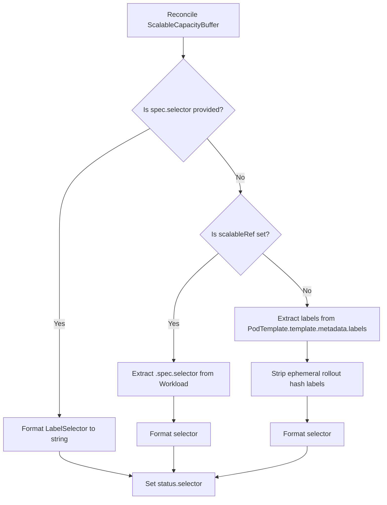
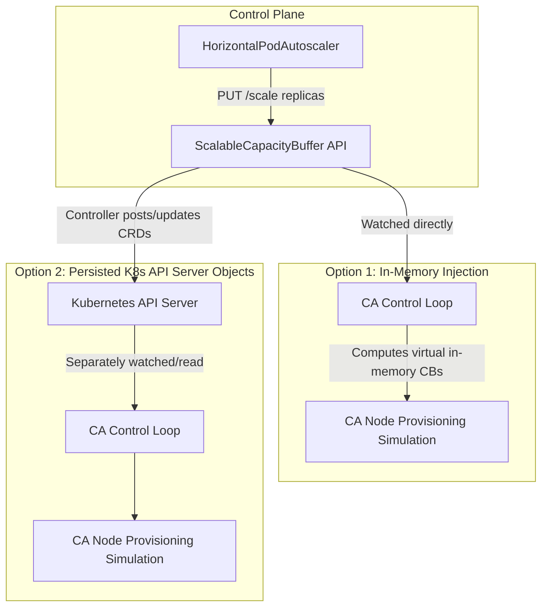

# Cluster Autoscaler Proposal: Scalable Capacity Buffers

**Author:** Konrad Kurdej ([@kkonrad](http://github.com/kkonrad)) \
**Contributors:** Krzysztof Siedlecki ([@krzysied](http://github.com/krzysied)),
Luiz Oliveira ([@laoj2](http://github.com/laoj2)) \
**Status:** Draft / Proposed \
**Target Repository:**
[kubernetes/autoscaler](https://github.com/kubernetes/autoscaler/tree/master/cluster-autoscaler/proposals)

--------------------------------------------------------------------------------

## 1. Executive Summary

Existing `CapacityBuffer` resources do a great job at declaratively defining
extra cluster capacity. This mechanism works well for cluster administrators by
guaranteeing immediate headroom for scheduled workloads, but those static
buffers incur extra infrastructure costs. We can minimize those costs
significantly if we adjust buffers properly over time.

This proposal introduces **`ScalableCapacityBuffer`** as a first-class,
Kubernetes-native API extension for the Cluster Autoscaler (CA). The core design
principle of `ScalableCapacityBuffer` is **strict architectural decoupling**:

*   The buffer resource defines **what** capacity to reserve (Pod resource
    shapes, tolerations) and **how many** units are currently reserved
    (`.spec.replicas`).
*   All dynamic sizing and scaling decisions are completely delegated to
    external, standardized Kubernetes autoscalers (such as
    `HorizontalPodAutoscaler` (HPA), KEDA, or custom controllers) via standard
    implementation of the Kubernetes `/scale` subresource.

Furthermore, this proposal establishes automated **label selector derivation**
to satisfy upstream Kubernetes HPA validation contracts and enable seamless,
automated capacity claim rate ($C_r$) metric collection.

--------------------------------------------------------------------------------

## 2. Motivation and Use Cases

### 2.1 Reducing Buffer Costs During Constant or Decreasing Load

In standard Kubernetes clusters, infrastructure elasticity is typically
reactive: when workloads scale up, pods enter the `Pending` state, triggering
Cluster Autoscaler (CA) to provision new worker nodes. Because cloud provider VM
provisioning and node bootstrapping take time, latency-sensitive workloads
experience degraded startup times.

To mitigate this startup latency, operators run static capacity buffers.
However, static buffers present a fundamental economic problem:

*   **Idle Waste During Steady State:** When cluster load is constant, a static
    buffer pool sits unutilized, incurring continuous cloud infrastructure
    costs.
*   **Overpayment During Decreasing Load:** When application traffic declines
    and workloads scale down, static buffers remain at full size, exacerbating
    cluster waste just when compute demand is dropping.

#### Step-by-Step Simulation: Fixed Replicas vs. Scalable Capacity Buffer

The following simulation compares a **fixed replicas Capacity Buffer** (fixed at 3 pods) against a **Scalable Capacity Buffer** (HPA scaling between 1 and 3 pods) over 12 time steps.

```
Legend:
  █ = Workload Pod (1 pod per block)
  ░ = Available Buffer Headroom (1 pod per symbol)
```

```
Time  Workload  Phase         fixed replicas Capacity Buffer      Scalable Capacity Buffer (HPA 1..3)
Step  Demand                  [Workload Need] + [Buffer Avail]    [Workload Need] + [Buffer Avail]
──────────────────────────────────────────────────────────────────────────────────────────────────────────────────────────────────────────────
 t=0    10      Initial       ██████████░░░ (13 pods)             ██████████░   (11 pods)  [Save 2]
 t=1    13      Ramp Up (+3)  █████████████ (13 pods)             █████████████ (13 pods)* <-- *Note: 2 pods had slow start due to no buffer available
 t=2    13      Pause         █████████████░░░ (16 pods)          █████████████░░░ (16 pods)  <-- Buffer fully re-creates to 3 pods!
 t=3    16      Ramp Up (+3)  ████████████████ (16 pods)          ████████████████ (16 pods)  <-- All 3 pods absorbed instantly (buffer -> 0)
 t=4    16      Pause         ████████████████░░░ (19 pods)       ████████████████░░░ (19 pods)  <-- Buffer fully re-creates to 3 pods!
 t=5    19      Ramp Up (+3)  ███████████████████ (19 pods)       ███████████████████ (19 pods)  <-- All 3 pods absorbed instantly (buffer -> 0)
 t=6    19      Stable        ███████████████████░░░ (22 pods)    ███████████████████░░░ (22 pods) (Pods arrive; HPA detects steady state)
 t=7    19      Stable        ███████████████████░░░ (22 pods)    ███████████████████░ (20 pods)  [Save 2] <-- Scales down to 1 pod
 t=8    16      Ramp Down(-3) ████████████████░░░ (19 pods)       ████████████████░ (17 pods)  [Save 2]
 t=9    13      Ramp Down(-3) █████████████░░░ (16 pods)          █████████████░   (14 pods)  [Save 2]
 t=10   10      Ramp Down(-3) ██████████░░░ (13 pods)             ██████████░     (11 pods)  [Save 2]
 t=11   10      Stable        ██████████░░░ (13 pods)             ██████████░     (11 pods)  [Save 2]
```

### 2.2 Mathematical Sizing: $B = C_r \times L_r$

To eliminate idle cost while guaranteeing rapid burst absorption, buffer
headroom must adapt dynamically to scheduling velocity. The optimal buffer size
($B$) at any point in time is governed by the **Capacity Claim Rate** ($C_r$,
net new incoming pods per second) and the **Node Refill Latency** ($L_r$,
seconds required for Cluster Autoscaler to provision a new ready node or extra
capacity in general):

$$B = C_r \times L_r$$

*   **Net Extra Capacity Consumed ($C_r$):** It is important to clarify that
    $C_r$ measures net extra capacity consumed. In a rolling replacement
    scenario where an existing pod is deleted and a new pod of the same size is
    created, the net capacity claim rate is equal to 0 because no additional
    cluster headroom is demanded.
*   **Idealized Metric Representation:** The $B = C_r \times L_r$ equation
    describes an idealized metric working in a perfect scenario. While this
    design outlines how to observe and compute part of this rate automatically,
    the decoupled `ScalableCapacityBuffer` architecture can work with any other
    metrics (such as queue depth, concurrency targets, or application telemetry)
    that might better correlate with cluster load.

--------------------------------------------------------------------------------

## 3. Limitations of Current Capacity Buffers

Before detailing the recommended architecture, it is critical to examine why
existing Capacity Buffer implementations cannot be used effectively in the
mentioned use cases.

### 3.1 Conflict of Authority (Monolithic Coupling)

Current capacity buffer designs attempt to embed autoscaling rules, percentage
calculations, and metric evaluation loops directly inside the buffer Custom
Resource Definition (CRD) and controller. This creates an architectural
**conflict of authority**:

*   If a `CapacityBuffer` internally calculates its own target replicas based on
    internal rules, cluster administrators cannot use standard Kubernetes
    tooling (`HorizontalPodAutoscaler`, KEDA, or VPA) to govern headroom.
*   Integrating custom scaling logic or external metrics adapters becomes
    impossible without modifying the core capacity buffer controller code.

### 3.2 Inability to Leverage Standard HPA Ecosystem Capabilities

Standard Kubernetes `HorizontalPodAutoscaler` (`autoscaling/v2`) provides
battle-tested, highly configurable scaling behavior controls:

*   **Stabilization Windows:**
    `.spec.behavior.scaleDown.stabilizationWindowSeconds` prevents thrashing and
    premature node de-provisioning during transient traffic dips.
*   **Rate Limits and Hysteresis:** Configurable scale-up/scale-down velocity
    limits (`policies.type: Percent` or `Replicas`).
*   **Multi-Metric Evaluation:** Simultaneously evaluating CPU, memory, external
    metrics (e.g., queue depth or claim rate), and object metrics.

Current capacity buffers lack these mature mechanisms and force engineering
teams to endlessly reimplement complex scaling heuristics inside the capacity
reservation controller.

### 3.3 Upstream HPA `/scale` Subresource Validation Mismatch

Standard Kubernetes HPA controllers enforce a strict API contract: the target
resource's `/scale` subresource **must** return a valid, non-empty serialized
label selector in `.status.selector`, and that selector is further validated by
HPA's **ambiguous selector check** to prevent multiple HPAs from targeting the
same set of pods. Legacy buffer primitives that represent purely virtual,
in-memory capacity lack concrete pods matching a label selector in the
Kubernetes API server, causing standard HPA controllers to reject them, flag
overlapping selectors when the buffered workload also uses an HPA, or
miscalculate pod readiness states (see Section 4.4 for detailed caveats and
potential upstream changes).

--------------------------------------------------------------------------------

## 4. Recommended Approach: `ScalableCapacityBuffer` (with Label Selectors)

To overcome these limitations, we recommend introducing
**`ScalableCapacityBuffer`** as a clean, decoupled API layer that implements the
Kubernetes `/scale` subresource and features deterministic label selector
derivation.

`ScalableCapacityBuffer` is designed to resemble the core `CapacityBuffer` API
as closely as possible, preserving familiar configuration patterns. However,
there are two intentional schema modifications that distinguish it:

1.  **Lack of `percentage` Field:** Proportional scaling rules are omitted
    because dynamic replica calculations are handled externally by HPA or custom
    autoscalers.
2.  **Lack of `limits` Field:** Upper and lower scaling boundaries
    (`minReplicas`, `maxReplicas`) are managed directly inside the HPA
    configuration rather than embedded in the buffer definition.
3.  **Identical Status Behavior:** The `.status` structure and semantics remain
    identical to `CapacityBuffer`, reflecting the actual provisioned replicas
    and observed conditions.

### 4.1 Core API Specification

```go
package v1alpha1

import (
    metav1 "k8s.io/apimachinery/pkg/apis/meta/v1"
)

// ScalableCapacityBufferSpec defines the desired state of ScalableCapacityBuffer.
type ScalableCapacityBufferSpec struct {
    // Replicas is the desired number of buffer units.
    // This field is mutated directly by external controllers (HPA/KEDA) via the /scale subresource.
    // +kubebuilder:validation:Minimum=0
    // +optional
    Replicas *int32 `json:"replicas,omitempty"`

    // PodTemplateRef references a standalone PodTemplate resource in the same namespace
    // defining the shape (CPU, memory, GPU, tolerations) of a single buffer unit.
    // Mutually exclusive with ScalableRef.
    // +optional
    PodTemplateRef *LocalObjectReference `json:"podTemplateRef,omitempty"`

    // ScalableRef references an existing Kubernetes workload (Deployment, StatefulSet, ReplicaSet)
    // in the same namespace. The controller extracts its Pod shape (.spec.template) and label selector.
    // Mutually exclusive with PodTemplateRef.
    // +optional
    ScalableRef *ObjectReference `json:"scalableRef,omitempty"`

    // Selector is an optional explicit label selector identifying the real workload pods
    // intended to consume this capacity buffer. Overrides automatic derivation.
    // +optional
    Selector *metav1.LabelSelector `json:"selector,omitempty"`

    // ProvisioningStrategy defines how infrastructure capacity is backed.
    // This field is immutable once set.
    // +kubebuilder:validation:XValidation:rule="self == oldSelf",message="ProvisioningStrategy is immutable"
    // +optional
    ProvisioningStrategy string `json:"provisioningStrategy,omitempty"`
}

type LocalObjectReference struct {
    Name string `json:"name"`
}

type ObjectReference struct {
    APIVersion string `json:"apiVersion,omitempty"`
    Kind       string `json:"kind"`
    Name       string `json:"name"`
}

// ScalableCapacityBufferStatus defines the observed state, identical in behavior to CapacityBuffer status.
type ScalableCapacityBufferStatus struct {
    // Replicas is the actual number of buffer units provisioned.
    Replicas int32 `json:"replicas,omitempty"`

    // Selector is the serialized label selector matching the buffered workload pods.
    // Required to satisfy the Kubernetes /scale subresource contract for HPA compatibility.
    Selector string `json:"selector,omitempty"`

    Conditions []metav1.Condition `json:"conditions,omitempty"`
}
```

### 4.2 `/scale` Subresource Exposure

The CRD schema exposes the `/scale` subresource via standard Kubebuilder / CRD
markers:

```go
// +kubebuilder:object:root=true
// +kubebuilder:subresource:status
// +kubebuilder:subresource:scale:specpath=.spec.replicas,statuspath=.status.replicas,selectorpath=.status.selector
```

### 4.3 Deterministic Label Selector Derivation Pipeline

To satisfy HPA validation contracts and provide an unambiguous query target for
metrics collectors measuring the Capacity Claim Rate ($C_r$), the controller
reconciles `.status.selector` using a strict four-stage hierarchy:



1.  **Stage 1 (Explicit Override):** If `.spec.selector` is explicitly defined,
    format and populate `.status.selector`.
2.  **Stage 2 (Workload Extraction):** If referencing a workload via
    `.spec.scalableRef` (e.g., `Deployment`), extract its `.spec.selector` and
    format to string.
3.  **Stage 3 (PodTemplate Synthesis):** If referencing a `PodTemplate`,
    synthesize a label selector from `.template.metadata.labels`.
    System-injected ephemeral labels (e.g., `pod-template-hash`,
    `controller-revision-hash`) are stripped so the selector remains invariant
    across application rollouts.
4.  **Stage 4 (Fallback):** Populate empty string `""` if no labels exist.

By populating `.status.selector`, external metrics collectors can automatically
watch pod creation events matching that selector to compute real-time claim rate
metrics (`capacity_buffer_claim_rate`) without manual metric configuration.

### 4.4 Open Caveats and Potential Required Changes in HPA (TODO / Community Feedback)

> **TODO / Request for Community Feedback:** While deriving `.status.selector`
> from the buffered workload satisfies HPA's non-empty selector contract and
> enables automated claim-rate ($C_r$) metric collection, it introduces an
> important interaction with upstream HPA validation that we plan to address
> soon and would like to brainstorm with the community.

1.  **HPA Ambiguous Selector Check (Overlapping Selectors):** In upstream
    Kubernetes, the HPA controller validates `.status.selector` not only for
    non-emptiness, but also to ensure that **multiple HPAs do not select an
    overlapping set of pods** (the *ambiguous selector check*, designed to
    prevent two HPAs from fighting over the replica count of the same workload).
    *   If a workload (e.g., `Deployment/my-app`) is already scaled by its own
        HPA (`HPA-1`), and a `ScalableCapacityBuffer` for that workload is
        scaled by a second HPA (`HPA-2`), deriving the workload's pod label
        selector in `ScalableCapacityBuffer.status.selector` causes both `HPA-1`
        and `HPA-2` to report identical or overlapping pod selectors.
    *   Even though `HPA-1` and `HPA-2` scale completely distinct
        `scaleTargetRef` objects (`Deployment` vs. `ScalableCapacityBuffer`) and
        do not conflict on `.spec.replicas`, upstream HPA's ambiguous selector
        check will flag them as conflicting unless that check is relaxed,
        scoped, or disabled for buffer resources.
    *   Similarly, if a `ScalableCapacityBuffer` represents generic cluster-wide
        headroom without workload labels (falling back to `""` in Stage 4),
        upstream HPA will reject the empty selector.
2.  **Pod Lister Queries vs. `External` `AverageValue` Metrics:** Upstream HPA
    uses `.status.selector` to list live pods and filter out unready or missing
    pods when computing Resource/Pod metrics or `External` metrics with
    `target.type: Value`. Because `ScalableCapacityBuffer` replicas represent
    virtual, unclaimed headroom rather than running pods, live pod counts do not
    match buffer `.status.replicas` (and may be `0` before a workload scales
    up). Using `External` metrics with `target.type: AverageValue` avoids
    querying the pod lister for replica calculation
    (`desiredReplicas = ceil(metricValue / targetAverageValue)`), relying only
    on `.status.replicas` from the `/scale` subresource.
3.  **Potential Paths Forward to Brainstorm:**
    *   **Option A — Scope or Relax the Ambiguous Selector Check in HPA:**
        Update upstream HPA validation so that overlapping `.status.selector`
        values are only treated as ambiguous when multiple HPAs target
        controllers that manage actual running pods, or allow virtual capacity
        resources to bypass pod-overlap validation.
    *   **Option B — Separate `/scale` Selector from Workload Claim Selector:**
        Populate `.status.selector` (mapped to `/scale`) with a unique,
        buffer-scoped synthetic selector (e.g.,
        `buffer.x-k8s.io/buffer-name=<name>`) so HPA's non-empty and
        non-overlapping selector validation passes out of the box across all
        existing Kubernetes versions (when using `External` `AverageValue`
        metrics), while exposing the derived workload selector in a dedicated
        status field (e.g., `.status.workloadSelector`) for the claim-rate
        ($C_r$) metrics collector.
    *   **Option C — Other Community Approaches:** We welcome feedback from
        `sig-autoscaling` on whether relaxing HPA's ambiguous selector check or
        decoupling the `/scale` selector is preferred.

--------------------------------------------------------------------------------

## 5. Concrete Configuration Examples (YAML)

Below is an end-to-end Kubernetes-native configuration demonstrating a decoupled
hardware shape, scalable buffer reservation, and HPA policy.

### 5.1 Step 1: The Shape Template (`PodTemplate`)

```yaml
apiVersion: v1
kind: PodTemplate
metadata:
  name: batch-worker-shape
  namespace: data-processing
template:
  metadata:
    labels:
      app.kubernetes.io/name: batch-worker
      tier: heavy-compute
  spec:
    containers:
    - name: reserve
      image: registry.k8s.io/pause:3.9
      resources:
        requests:
          cpu: "8"
          memory: "32Gi"
```

### 5.2 Step 2: The Scalable Buffer (`ScalableCapacityBuffer`)

```yaml
apiVersion: buffer.x-k8s.io/v1alpha1
kind: ScalableCapacityBuffer
metadata:
  name: batch-worker-buffer
  namespace: data-processing
spec:
  replicas: 2 # Dynamically mutated by HPA
  podTemplateRef:
    name: batch-worker-shape
  provisioningStrategy: buffer.x-k8s.io/active-capacity
```

### 5.3 Step 3: The Scaling Policy (`HorizontalPodAutoscaler`)

```yaml
apiVersion: autoscaling/v2
kind: HorizontalPodAutoscaler
metadata:
  name: batch-worker-buffer-hpa
  namespace: data-processing
spec:
  scaleTargetRef:
    apiVersion: buffer.x-k8s.io/v1alpha1
    kind: ScalableCapacityBuffer
    name: batch-worker-buffer
  minReplicas: 0 # Scales to 0 during zero pod scheduling activity
  maxReplicas: 50
  metrics:
  - type: External
    external:
      metric:
        name: capacity_buffer_claim_rate # Measured rate of matching Pod creations
        selector:
          matchLabels:
            buffer_name: batch-worker-buffer
      target:
        type: Value
        # Note: This target value must take into account the total time required for a newly
        # provisioned node to become ready. This includes VM boot latency and the initialization
        # time of any DaemonSet pods that must run before workloads can schedule.
        value: "0.0167"
  behavior:
    scaleUp:
      stabilizationWindowSeconds: 0 # Instant scale-up upon claim surges
      policies:
      - type: Percent
        value: 100
        periodSeconds: 15
    scaleDown:
      stabilizationWindowSeconds: 600 # 10-minute cooldown prevents node churn
      policies:
      - type: Replicas
        value: 1
        periodSeconds: 60
```

--------------------------------------------------------------------------------

## 6. Why `CapacityBuffer` Primitives Are Still Needed

While `ScalableCapacityBuffer` acts as the user-facing, autoscaler-compatible
facade, core foundational **`CapacityBuffer`** primitives remain essential in
the architecture for three key reasons:

### 6.1 Supporting Broader Provisioning Strategies

A standardized buffer execution engine must support diverse infrastructure
provisioning models. Furthermore, there might be provisioning strategies that
are not a good fit for being scaled dynamically—for example, a one-shot buffer
that provisions a dedicated block of extra capacity once during cluster
initialization and never re-creates or scales it. A core `CapacityBuffer`
primitive cleanly abstracts these varied execution mechanics away from the
scaling facade.

### 6.2 Handling Percentage-of-Workload Scaling

While HPA excels at metric-driven scaling ($B = C_r \times L_r$), many cluster
administrators require baseline proportional buffering (e.g., *“Maintain buffer
headroom equal to exactly 15% of the active replica count of
`deployment/web-app`”*). Standard Kubernetes HPA does not natively support
scaling target $A$ as a percentage of target $B$'s replicas without complex
external metric bridges. A lower-level `CapacityBuffer` primitive can natively
implement percentage-to-replica translation loops for proportional baseline
headroom.

### 6.3 Serving as the Execution Backbone for `ScalableCapacityBuffer`

`ScalableCapacityBuffer` acts as an architectural wrapper. It delegates the
complex infrastructure realization (interacting with Cluster Autoscaler
simulation, scheduler predicates, and node provisioning) to core
`CapacityBuffer` mechanics.

--------------------------------------------------------------------------------

## 7. Cluster Autoscaler Implementation Architecture

When integrating `ScalableCapacityBuffer` with Kubernetes Cluster Autoscaler
(CA), we evaluate two architectural implementation options.



### 7.1 Option 1: In-Memory Virtual Injection (Recommended)

In this approach, the Cluster Autoscaler directly watches
`ScalableCapacityBuffer` resources from the Kubernetes API server. When
reconciling cluster headroom, the controller computes **virtual, in-memory
`CapacityBuffer` objects** injected directly into the Cluster Autoscaler
simulation engine. No intermediate resources are sent, posted, or created in the
Kubernetes API server.

*   **Primary Advantages:**
    *   **Minimal API Server Strain:** Eliminates write amplification.
        High-frequency HPA scaling events update only `.spec.replicas` on the
        single `ScalableCapacityBuffer` object without cascading CRUD operations
        across secondary CRDs.
    *   **Zero Synchronization Latency:** Updates to buffer sizes take effect
        instantaneously in the next CA reconciliation loop without waiting for
        secondary controller watch propagation.
    *   **Operational Simplicity:** Avoids garbage collection complexities,
        orphaned objects, and controller race conditions.

### 7.2 Option 2: Persisted API Server CRD Management

In this alternative approach, the `ScalableCapacityBuffer` controller acts as an
operator that explicitly creates, updates, and deletes real `CapacityBuffer`
custom resources posted to the Kubernetes API server. These persisted objects
are then separately watched and read within the Cluster Autoscaler control loop.

*   **Primary Advantage:**
    *   **Standalone Controller Execution:** The `ScalableCapacityBuffer`
        controller can run entirely outside of Cluster Autoscaler as an
        independent control plane component, keeping the core CA codebase
        untouched by high-level buffer management. Crucially, this means the
        implementation could potentially be re-used across different autoscalers
        (such as Cluster Autoscaler and Karpenter) while being parameterized
        only by the list of supported scalable provisioning strategies.
*   **Critical Disadvantages:**
    *   **High API Server Load:** Rapid scaling events produce continuous
        PUT/PATCH requests sent to the Kubernetes API server.
    *   **Reconciliation Hop Latency:** Multi-controller watch loops introduce
        delay between HPA scaling decisions and Cluster Autoscaler observation.
    *   **Lifecycle Complexity:** Requires strict finalizer management to ensure
        child `CapacityBuffer` CRDs are cleanly garbage collected when parent
        objects are deleted or modified.

**Recommendation:** **Option 1 (In-Memory Virtual Injection)** is strongly
recommended for mainstream open-source Cluster Autoscaler adoption due to its
scalability, low control plane latency, and minimal footprint.

--------------------------------------------------------------------------------

## 8. Not Recommended Alternatives

For completeness, we briefly document alternative architectural patterns
evaluated during the design phase and explain why they are **not recommended**.

### 8.1 Monolithic `CapacityBuffer` with Internal Autoscaling Engine

*   **Concept:** Adding metric thresholds, percentage math, claim-rate ($C_r$)
    scaling fields, and scaling intervals directly into a monolithic
    `CapacityBuffer` CRD executed internally within the capacity buffer
    controller or Cluster Autoscaler control loop.
*   **Why Rejected:** Violates core Kubernetes modularity design principles.
    Duplicates core HPA functionality, confines scaling heuristics to internal
    control loops, conflicts with external scalers (KEDA/VPA), and forces the
    controller to maintain complex hysteresis and cooldown algorithms.

### 8.2 Proxy / Wrapper CRD Layer (`ScalingWrapperForCB`)

*   **Concept:** Retaining non-scalable `CapacityBuffer` objects and introducing
    a separate proxy CRD (`ScalingWrapperForCB`) that implements `/scale` and
    translates HPA calls into mutations on the underlying buffer.
*   **Why Rejected:** Introduces confusing double-indirection for cluster
    operators (`HPA` $\rightarrow$ `ScalingWrapperForCB` $\rightarrow$
    `CapacityBuffer`). Creates unnecessary control plane boilerplate without any
    functional benefit over a clean unified `ScalableCapacityBuffer` API.

### 8.3 `ScalableCapacityBuffer` Without Label Selector

*   **Concept:** Omitting the label selector derivation pipeline and returning
    an empty string in `.status.selector`.
*   **Why Rejected:** Standard Kubernetes `HorizontalPodAutoscaler` controllers
    enforce strict validation requiring a non-empty, valid label selector on
    target scale subresources, and metrics collectors calculating $C_r$ need a
    deterministic selector to identify which incoming pods consume the buffer.
    Returning an empty selector would fail HPA validation out of the box and
    leave metrics collectors without a target selector (note that interaction
    with HPA's overlapping/ambiguous selector check still requires addressing as
    detailed in Section 4.4).

### 8.4 Adjusting Existing `CapacityBuffer` to be a Scalable Subresource

*   **Concept:** Instead of introducing a new `ScalableCapacityBuffer` CRD,
    mutate the existing `CapacityBuffer` CRD to implement the `/scale`
    subresource (`.spec.replicas` / `.status.replicas`) so standard HPA can
    target it directly. Several variations of this approach were evaluated:
    *   **Option 1A (Drop Percentage for HPA):** Make `CapacityBuffer` a
        scalable resource, remove `.spec.percentage` from the API definition,
        and rely strictly on HPA for scaling.
    *   **Option 1B (Drop Percentage + Deployment Replica Metric):** Make
        `CapacityBuffer` scalable and drop `.spec.percentage`, while introducing
        a deployment/controller replica count metric so HPA can reproduce
        proportional buffer sizing.
    *   **Option 4 (Coexisting Percentage and `/scale`):** Make `CapacityBuffer`
        scalable while attempting to adjust controller semantics to allow both
        internal `percentage` calculations and HPA mutations.
    *   **Option A (Mode-Guarded Scalability):** Allow both modes on
        `CapacityBuffer`, but require explicit annotation or provisioning
        strategy flags indicating autoscaling intent, rejecting configurations
        where `percentage` is set on an autoscaled buffer.
*   **Why Rejected:**
    *   **Backward Incompatibility:** Dropping `.spec.percentage` from existing
        `CapacityBuffer` definitions is a breaking change for existing users who
        rely on declarative proportional headroom. Users would be forced to
        rewrite existing buffer definitions into HPA objects or multi-object
        configurations.
    *   **Conflict of Authority:** If `.spec.percentage` and `/scale`
        (`.spec.replicas`) coexist without strict mutual exclusion, the
        `CapacityBuffer` controller and external HPA fight over
        `.spec.replicas`. If HPA attempts to scale down `.spec.replicas` to 2
        but the controller enforces `max(spec.replicas, percentage *
        target.replicas) = 5`, HPA control actions are ignored, causing
        unpredictable loop oscillations or freeze states.
    *   **Preserving Primitive Responsibility:** Maintaining `CapacityBuffer` as
        a stable, non-scalable foundational primitive (Section 6) allows it to
        cleanly act as the underlying hardware provisioning backbone for diverse
        strategies (including non-scalable one-shot buffers), while
        `ScalableCapacityBuffer` serves as the dedicated autoscaling facade.

### 8.5 Dedicated `CapacityBufferAutoscaler` (`CBA`) CRD

*   **Concept:** Retain `CapacityBuffer` as a static reservation primitive and
    introduce a new, dedicated `CapacityBufferAutoscaler` (`CBA`) CRD analogous
    to `HorizontalPodAutoscaler`. A dedicated CBA controller would watch `CBA`
    objects, execute evaluation loops, perform validation, and scale
    `CapacityBuffer` replicas directly. To minimize control plane overhead, an
    alternative implementation shortcut evaluated injecting virtual "Fake HPA"
    objects directly into the core HPA controller reconciliation loop.
*   **Primary Advantages:** Provides an API explicitly tailored to capacity
    buffers, enabling custom `workloadPercentage` scaling alongside standard HPA
    metrics without conflicts, while requiring no breaking changes to
    `CapacityBuffer`.
*   **Why Rejected:**
    *   **Requires Modifications to Current Capacity Buffers:** Doing this
        cleanly still requires modifications to current `CapacityBuffer`
        resources (specifically, the removal or deprecation of internal
        percentage mode) to prevent conflicting scaling mechanisms and redundant
        percentage loops.
    *   **Ecosystem Isolation:** A custom autoscaler CRD does not benefit from
        wider Kubernetes tooling (such as KEDA, VPA, GitOps metric visualizers,
        and standardized HPA status reporting) that natively integrates with
        `/scale`-enabled resources.
